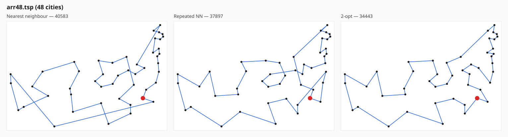

# The-Salesman-Problem

[](https://github.com/Daneto123/The-Salesman-Problem/actions/workflows/build.yml)

**Задачата за търговския пътник**: да се намери най-краткият маршрут, който минава през всеки град точно веднъж и се връща в началния.

Проектът е писан по предмета „Структури от данни“ през зимния семестър на 2020/2021 г. на C++. Оригиналната университетска версия е запазена непроменена в бранча [`university-2020`](https://github.com/Daneto123/The-Salesman-Problem/tree/university-2020). Описание на алгоритмите има в [documentation.pdf](documentation.pdf).



## Алгоритми

| Алгоритъм | Какво прави | Сложност |
|---|---|---|
| Най-близък съсед (`nn`) | От текущия град винаги отива в най-близкия непосетен | O(n²) |
| Повторен най-близък съсед (`rnn`) | Пуска „най-близък съсед“ от всеки град и взима най-краткия маршрут | O(n³) |
| 2-opt (`2opt`) | Подобрява маршрута на `rnn`, като обръща участъци, докато има полза. Работи и за несиметрични графи (`.atsp`) | O(n²) на обхождане |
| Or-opt (`oropt`) | Редува 2-opt и Or-opt: мести вериги от 1–3 поредни града на най-доброто друго място в маршрута. Веригата запазва посоката си, затова помага много при несиметрични графи | O(n²) на обхождане |
| Точно решение (`exact`) | Динамично програмиране на Held-Karp. Дава истинския оптимум, но само до 18 града | O(n²·2ⁿ) |

Евристиките са бързи, но не гарантират оптимум. Затова програмата ги пуска всички и ги сравнява.

## Компилиране

Нужни са CMake 3.16+ и компилатор с C++17 (GCC, Clang или MSVC). Работи на Windows, Linux и macOS.

```bash
cmake -B build
cmake --build build --config Release
```

Изпълнимият файл е `build/tsp` (на Windows `build\Release\tsp.exe`).

## Използване

```bash
tsp data/arr48.tsp                      # всички алгоритми
tsp data/br17.atsp --start 3            # започва от град 3
tsp data/rbg403.atsp --algo oropt       # само един алгоритъм
tsp data/arr48.tsp --svg arr48.svg      # картинка на маршрутите (отваря се в браузър)
tsp data/arr48.tsp --out tours.txt      # записва маршрутите във файл
```

Без аргументи програмата пита за файла и началния град, както в оригиналната версия.

| Опция | Значение |
|---|---|
| `-s, --start N` | начален град, от 0 (по подразбиране 0) |
| `-a, --algo NAME` | `nn`, `rnn`, `2opt`, `oropt`, `exact` или `all` (по подразбиране) |
| `-t, --type TYPE` | `auto` (по подразбиране), `matrix` или `points` |
| `-o, --out FILE` | записва маршрутите във файл |
| `--svg FILE` | рисува маршрутите; само за файлове с координати |

## Формат на входните файлове

Първият ред е броят на градовете `n`. След него има един от двата варианта:

- **матрица** (`.atsp`): `n × n` разстояния; може и несиметрична;
- **точки** (`.tsp`): `n` реда `номер x y`; разстоянието е евклидовото, закръглено до цяло число (както в TSPLIB).

Типът се познава автоматично. Поддържат се и стандартни [TSPLIB](http://comopt.ifi.uni-heidelberg.de/software/TSPLIB95/) файлове с `EUC_2D` координати или `FULL_MATRIX`. Ако заглавният ред не отговаря на данните (например `ftv64` всъщност е 65 × 65), се използват данните и се показва предупреждение.

## Резултати

Дължини на маршрутите при начален град 0 (по-малко е по-добре):

| Файл | Градове | Най-близък съсед | Повторен НС | 2-opt | 2-opt + Or-opt | Оптимум |
|---|---:|---:|---:|---:|---:|---:|
| 16.tsp | 16 | 55 | 53 | 53 | 53 | **52** |
| br17.atsp | 17 | 92 | 56 | **39** | **39** | **39** |
| arr48.tsp | 48 | 40583 | 37897 | 34443 | **34265** | — |
| ftv64.atsp | 65 | 2639 | 2202 | 2170 | **2038** | — |
| ftv170.atsp | 171 | 3923 | 3582 | 3536 | **3196** | — |
| ftv323.atsp | 323 | 1734 | 1702 | 1695 | **1404** | — |
| rbg403.atsp | 403 | 3535 | 3497 | 3497 | **2473** | — |
| pbm436.tsp | 436 | 1739 | 1683 | 1546 | **1519** | — |
| xql662.tsp | 662 | 3124 | 3010 | 2754 | **2625** | — |
| rbx711.tsp | 711 | 3890 | 3557 | 3343 | **3244** | — |

2-opt почти винаги подобрява най-близкия съсед и това става за милисекунди дори при 700 града. При несиметричните графи обаче 2-opt помага малко, защото обръщането на участък сменя посоката на всички ребра в него. Там Or-opt прави голямата разлика: при rbg403 маршрутът пада от 3497 на 2473, т.е. с около 29%, за под 10 ms.

## Тестове

```bash
ctest --test-dir build -C Release --output-on-failure
```

Тестовете проверяват дали всички файлове в `data/` се зареждат и дали маршрутите са валидни. Освен това сравняват Held-Karp с пълно изчерпване на случайни графи, а 2-opt и Or-opt не бива да дават по-лош маршрут от началния. GitHub Actions ги пуска на Windows, Linux и macOS при всеки push.

## Структура

```
src/
  graph.*       граф с матрица на разстоянията
  io.*          четене на входните файлове
  algorithms.*  най-близък съсед, 2-opt, Or-opt, Held-Karp
  svg.*         рисуване на маршрутите
  main.cpp      команден ред
tests/          автоматични тестове
data/           примерни входни данни
```
